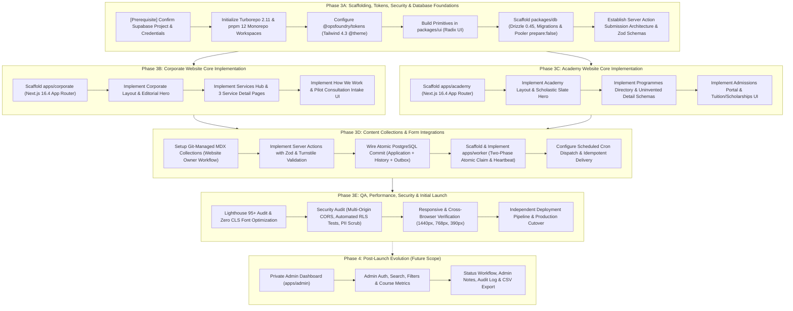

# OPS FOUNDRY — PRODUCTION IMPLEMENTATION ROADMAP
**Engineering Execution Plan, Milestones, Acceptance Criteria & Governance Gates**  
**Document Location:** `design/architecture/IMPLEMENTATION_ROADMAP.md`  
**Phase:** Phase 3 — Production Architecture & Implementation Planning  
**Status:** Canonical Technical Specification (Final Security & Version Consistency)  
**Date:** November 15, 2026  

---

## 1. Roadmap Overview & Strategic Phasing

This implementation roadmap establishes the engineering plan to translate the approved UX architecture, Direction C design foundations, and canonical production architecture into two production-grade digital web properties.

### Two-Stage Strategic Horizon:
1. **Initial Release (Phase 3A through Phase 3E):**
   * Corporate commercial website (`opsfoundry.com`).
   * Academy commercial website (`academy.opsfoundry.com`).
   * Git-managed content architecture personally maintained by the website owner.
   * Public admissions application and corporate consultation intake forms.
   * Persistent managed database storage (Supabase PostgreSQL) with **transactional outbox commits**.
   * Dedicated outbox worker (`apps/worker`) executed via scheduled hosting cron for transactional emails (Resend) and operational alerts (Slack/CRM).
   * Automated Row Level Security (RLS) and database connection test suites.
2. **Future Phase (Phase 4 Post-Launch):**
   * Private Ops Foundry Admin Dashboard (`apps/admin`).
   * Administrator authentication, application search/filtering, and course metric breakdowns.
   * Status workflow management, administrative notes, audit trails, and CSV exports.
   * Additional admissions workflow functionality upon institutional approval.

### Core Execution Principles:
* **Foundational Architecture First (Phase 3A):** Monorepo structure, design tokens, UI primitives, database schema, migrations, connection pooler configuration, and RLS test suites are established in Phase 3A before any frontend pages are assembled.
* **Strict Scope Boundaries:** Phase 3 delivers commercial lead generation and applicant intake. The Admin Dashboard, LMS software, student authentication portals, and payment gateways are explicitly deferred to Phase 4+.
* **Durable Background Execution:** The notification architecture never assumes a serverless request remains alive after sending a response. Outbox jobs are processed via dedicated cron worker invocations using a two-phase atomic lease protocol with 30s heartbeats.
* **Least-Privilege Security & Minimal Worker PII:** Database roles enforce strict least privilege. The worker processes strictly minimal notification payloads, while full application records remain inaccessible to the worker role.
* **Continuous Automated Verification:** Every milestone must pass automated TypeScript typechecking, ESLint validation, responsive viewport tests (1440px, 768px, 390px), automated RLS policy tests, and CI builds before progression.

---

## 2. Dependency Flow & Milestone Graph



---

## 3. Detailed Phase Breakdown, Deliverables & Acceptance Criteria

### Phase 3A: Monorepo Scaffolding, Shared Tokens, Security & Database Foundations `[Confirmed]`
* **Objective:** Establish the Turborepo monorepo, TypeScript base configuration, Tailwind CSS 4.3 design tokens, shared accessible primitives, durable Supabase database schema, migration pipeline, connection pooler configuration, and automated RLS security tests.
* **Planning Dependencies (Confirmed):**
  * Node.js `22.12.0 LTS`, `pnpm 12.19.0`, and `TypeScript 7.0.2` environment configured.
  * Supabase project instances established with isolated development and staging credentials.
  * Drizzle ORM schema specification confirmed (stable course codes, status check constraints, append-only history table, transactional outbox with lease fields).
* **Deliverables:**
  * Root workspace manifest (`pnpm-workspace.yaml`, `package.json`, `turbo.json`, `tsconfig.base.json`).
  * Explicit Monorepo Structure: `apps/corporate`, `apps/academy`, `apps/worker`, `packages/tokens`, `packages/ui`, `packages/types`, `packages/db` (with `apps/admin` explicitly reserved but strictly unimplemented).
  * `packages/tokens`: Color tokens (`#FF5A1F`, `#FBFBF9`, `#111215`, `#1E232E`), typography hierarchies (Manrope + Plus Jakarta Sans), and Tailwind 4.3 `theme.css`.
  * `packages/ui`: Accessible, unstyled Radix UI primitives (`Button`, `Container`, `Input`, `Textarea`, `Select`, `Modal`). No forced `themeVariant` anti-patterns.
  * `packages/types`: Shared TypeScript interfaces and Zod schemas for corporate services, academy programmes, form responses, and minimal outbox job payloads.
  * `packages/db`:
    * Drizzle ORM schema defining `admissions_applications`, `admissions_status_history`, `notification_outbox`, and `corporate_inquiries`.
    * Version-controlled SQL migrations (`packages/db/migrations/`).
    * Serverless connection pooler client connecting via Supabase Transaction Pooler (port 6543) with `prepare: false`.
    * Shared database queries (`claimOutboxJobs`, `heartbeatOutboxJob`, `completeOutboxJob`, `failOutboxJob`).
    * Automated RLS test suite (`packages/db/tests/rls.test.ts`) validating that anonymous clients have zero read/write access.
  * Environment Secret Configuration: Template `.env.example` files isolating development, preview, and production secrets.
* **Explicit Acceptance Criteria:**
  1. `pnpm build`, `pnpm lint`, and `pnpm typecheck` execute cleanly with 0 errors across all workspace packages.
  2. Database migration executes cleanly against local/staging Supabase PostgreSQL instance.
  3. Database client successfully executes test queries over Supabase Transaction Pooler with `prepare: false`.
  4. Automated RLS test suite executes in CI and asserts that anonymous queries return permission denied or 0 records.
  5. Shared primitives render cleanly in isolation with full keyboard accessibility (WAI-ARIA compliance).

---

### Phase 3B: Corporate Website Core Implementation (`apps/corporate`) `[Confirmed]`
* **Objective:** Build the complete corporate commercial website reproducing the approved visual prototype.
* **Dependencies:** Successful completion of Phase 3A.
* **Deliverables:**
  * Global Corporate Layout: Authoritative sticky header with `Ops Foundry Academy ↗` cross-navigation pill, and industrial Carbon Black footer.
  * Corporate Homepage (`/`):
    * Asymmetric editorial hero with Manrope typography (`leading-[1.12]`) and operations collaboration photography.
    * *Why Ops Foundry Exists* editorial contrast section.
    * *The Three Operating Pillars* (Managed Teams, Structured Workflows, AI Tools).
    * *Three Ways We Get Work Done* full-width service rows (*Get Online*, *Get Visible*, *Get Customers* — clearly marked as proposed scopes under review).
    * *How We Work* proposed 4-stage operating model with commercial review disclaimer.
    * *Ops Foundry Academy* talent engine bridge container.
    * *Pilot Consultation Intake* presentation container.
  * Dedicated Routes:
    * Services Overview (`/services`) and Service Detail Pages (`/services/[slug]`).
    * How We Work (`/how-we-work`) operating model.
    * About (`/about`) leadership and institutional credibility.
    * Pilot Consultation (`/pilot`) dedicated intake page.
* **Explicit Acceptance Criteria:**
  1. 100% visual fidelity matching the approved visual prototype.
  2. Fully responsive layout verified at Desktop (1440px), Tablet (768px), and Mobile (390px).
  3. All deliverables and timelines explicitly marked as proposed scopes under review.
  4. Build compiles independently: `turbo run build --filter=corporate` succeeds in isolation.

---

### Phase 3C: Academy Website Core Implementation (`apps/academy`) `[Confirmed]`
* **Objective:** Build the complete Ops Foundry Academy web experience with its distinct scholastic personality.
* **Dependencies:** Successful completion of Phase 3A.
* **Deliverables:**
  * Global Academy Layout: Scholastic slate sticky header with `Ops Foundry Corporate ↗` cross-navigation pill, and scholastic slate footer.
  * Academy Homepage (`/`):
    * Welcoming hero with authentic workshop collaboration photography.
    * Practical learning methodology (No passive lectures).
    * Three neutral course preview cards (**Course One**, **Course Two**, **Course Three** bound to stable IDs `COURSE_01`, `COURSE_02`, `COURSE_03`).
    * *How Learning Works* dark slate section detailing simulations, AI tools, and output review.
    * Tuition & Scholarship introductory callout (provisional figures).
    * Career readiness section & Institutional Sponsor callout.
  * Dedicated Routes:
    * Programmes Directory (`/programmes`) with neutral placeholders and single contextual links.
    * Course Detail Pages (`/programmes/[slug]`) adhering strictly to the uninvented content schema.
    * Admissions Portal (`/admissions`) with 3-stage process explanation and application form UI.
    * Tuition & Scholarships (`/tuition-scholarships`) with transparent placeholder matrices.
    * Sponsors (`/sponsors`) institutional partnership outline.
* **Explicit Acceptance Criteria:**
  1. Distinct visual identity in Scholastic Slate (`#1E232E`) without inheriting corporate styling.
  2. Zero invented curriculum modules or unconfirmed prerequisites ("basic computer literacy" removed).
  3. Fully responsive layout verified across 1440px, 768px, and 390px viewports.
  4. Build compiles independently: `turbo run build --filter=academy` succeeds in isolation.

---

### Phase 3D: Content Collections, Form Integrations & Notification Worker `[Confirmed]`
* **Objective:** Connect Git-managed MDX content collections for the website owner and implement the end-to-end transactional outbox intake engine and decoupled worker.
* **Dependencies:** Successful completion of Phase 3B and Phase 3C.
* **Deliverables:**
  * Git-Managed MDX Content Collections: Services collections (`content/services/*.mdx`) and Programmes collections (`content/programmes/*.mdx`) validated against Zod frontmatter schemas.
  * Server Actions for Corporate Pilot Form and Academy Admissions Form.
  * Cloudflare Turnstile bot challenge integration.
  * **Atomic PostgreSQL Transactions:**
    * Academy: Atomic write to `admissions_applications`, `admissions_status_history`, and `notification_outbox`.
    * Corporate: Atomic write to `corporate_inquiries` and `notification_outbox` via `ops_corp_runtime`.
  * **Dedicated Notification Worker (`apps/worker`):**
    * Implements two-phase atomic claiming: locks rows with `FOR UPDATE SKIP LOCKED`, sets `status = 'processing'`, generates unique `claim_id`, sets `lease_expires_at = NOW() + 2 min`, and commits immediately.
    * Executes 30s heartbeat renewal query (`lease_expires_at > NOW()` validation).
    * Processes minimal notification payloads only; logs redact email local-parts (`a***@example.com`).
    * Executes external dispatches outside the database transaction with provider idempotency headers (`Idempotency-Key` for Resend, `X-OpsFoundry-Delivery-ID` for webhooks).
    * Updates outcome (`completed` or rescheduled `pending` with exponential backoff) requiring matching `claim_id`.
    * Marks jobs failing 5 attempts as `dead_letter` and triggers alerts.
    * Automatically recovers expired leases (`lease_expires_at <= NOW()`).
  * Scheduled cron trigger configured on hosting provider (frequency provisional).
* **Explicit Acceptance Criteria:**
  1. **Atomic Outbox Guarantee:** Submitting an application writes the application, initial audit record, and outbox jobs in a single atomic transaction before the client receives confirmation.
  2. **Worker Decoupling:** Server Actions return immediately after transaction commit; zero unawaited background work executes in the user's HTTP request lifecycle.
  3. **Concurrency-Safe Outbox Processing:** The worker claims pending jobs using `FOR UPDATE SKIP LOCKED` and stamps a lease, preventing duplicate processing under concurrent worker runs.
  4. **Fencing & Stale Worker Rejection:** Conditional updates require the current `claim_id`; stale workers cannot overwrite newer worker results.
  5. **Retry Backoff & Dead Letter:** Transient network errors trigger exponential retry backoff; permanently failing jobs (5 attempts) are marked `dead_letter` and trigger alerts.
  6. **Duplicate Prevention & Idempotency:** Submissions with identical scoped idempotency key resolve idempotently without creating duplicate database rows or queueing redundant outbox jobs.
  7. **PII-Free Logging & Payload Minimization:** Worker logs redact email local-parts; payloads exclude full application forms.

---

### Phase 3E: Verification, Performance, Security & Initial Launch `[Confirmed]`
* **Objective:** Conduct rigorous end-to-end quality assurance, performance audits, security validation, and production cutover.
* **Dependencies:** Successful completion of Phase 3D.
* **Deliverables:**
  * **Lighthouse Audit:** Verified 95+ score on Performance, Accessibility, Best Practices, and SEO.
  * **Zero Cumulative Layout Shift (CLS):** `next/font` preloads Manrope and Plus Jakarta Sans locally with zero shift.
  * **Security Audit:**
    * Multi-Origin CORS policy verified for `opsfoundry.com`, `www.opsfoundry.com`, and `academy.opsfoundry.com`.
    * PostgreSQL Row Level Security verified: anonymous reads and writes completely revoked.
    * Database user privilege separation verified (`apps/worker` cannot SELECT from `admissions_applications` or `corporate_inquiries`; `apps/corporate` cannot access Academy records).
    * Secret keys verified strictly server-side (zero exposed client tokens).
    * Explicit privacy policy consent checkboxes verified on both forms.
  * **Independent CI/CD Pipelines:**
    * GitHub Actions workflow triggers independent builds: committing to `apps/corporate` does not trigger deployment of `apps/academy` or `apps/worker`.
  * **Production Cutover `[Pending stakeholder approval]`:**
    * Domain verification and SSL provisioning on Vercel/Netlify.
    * DNS cutover for apex domain and academy subdomain.
* **Explicit Acceptance Criteria:**
  1. Both properties achieve Lighthouse 95+ across mobile and desktop.
  2. End-to-end form intake verified in production staging with live Supabase database recording, outbox job queueing, and confirmation email delivery.
  3. Zero broken links, zero console errors, and zero layout shifts across evergreen browsers (Chrome, Edge, Safari, Firefox).

---

## 4. Phase 4: Post-Launch Evolution — Private Admin Dashboard `[Confirmed Future Scope]`

In Phase 4, after the initial public websites are successfully launched, a private **Ops Foundry Admin Dashboard** will be built in `apps/admin` to empower administrators to manage admissions and commercial inquiries.

### Phase 4A: Private Admin Dashboard Implementation
* **Objective:** Build an authenticated administrative tool to view, search, filter, and update submitted applications.
* **Architecture:** Deployed as `apps/admin` within the monorepo, consuming the shared `packages/db` package.
* **Planned Features:**
  1. **Administrator Authentication:** Secure login via Supabase Auth with Role-Based Access Control (`role = 'admin'`) and MFA.
  2. **Application Metrics Overview:** Real-time counters showing total applications, active cohort volume, and status distributions.
  3. **Applicant Directory:** Searchable table listing applicants by name, email, course code (`COURSE_01`, `COURSE_02`, `COURSE_03`), submission timestamp, and status.
  4. **Detailed Applicant Inspector:** View complete validated application responses, motivation text, and contact information.
  5. **Course Breakdown & Filtering:** Filter applicants by Course Code and submission status.
  6. **Status Lifecycle Updates:** One-click status updates (`submitted` $\rightarrow$ `in_review` $\rightarrow$ `approved` / `rejected` / `waitlisted` / `archived`).
  7. **Audit Trail Recording:** Automatically writes to `admissions_status_history` logging `from_status`, `to_status`, `changed_at`, `changed_by` (admin UUID), and review note.
  8. **CSV / Excel Data Export:** Export filtered application datasets for admissions review meetings.
* **Explicit Phase 4 Boundary:**
  * The dashboard does **not** include a public student portal, LMS course player, video hosting, automated grading, or payment processing. Those capabilities belong to Phase 5.

---

## 5. Stakeholder Governance Gates

To ensure strict alignment with commercial and institutional leadership, four mandatory sign-off gates are established:

```
┌─────────────────────────────────────────────────────────────────────────────────────────────┐
│                             STAKEHOLDER GOVERNANCE GATES                                    │
├────────┬─────────────────────────────┬──────────────────────────────────────────────────────┤
│ Gate   │ Milestone Timing            │ Required Sign-Off Items                              │
├────────┼─────────────────────────────┼──────────────────────────────────────────────────────┤
│ Gate 1 │ End of Phase 3A             │ Monorepo structure, Tailwind 4.3 theme, Supabase     │
│        │                             │ schema (outbox), pooler config & RLS test suite      │
│ Gate 2 │ End of Phase 3B & 3C        │ Staging visual review of Corporate & Academy websites│
│ Gate 3 │ During Phase 3D             │ Confirmation of operational triage destination (CRM) │
│        │                             │ and outbox cron execution schedule                   │
│ Gate 4 │ Prior to Phase 3E Cutover   │ DNS registrar access, domain ownership, legal notice │
└────────┴─────────────────────────────┴──────────────────────────────────────────────────────┘
```

---

## 6. Risk Assessment & Operational Mitigations

| Risk Factor | Probability | Impact | Mitigation Strategy |
| :--- | :---: | :---: | :--- |
| **Data Loss from Webhook Failures** | Zero | High | **Fully Mitigated:** Transactional notification outbox commits with application in one atomic transaction. Outbox worker retries with backoff. |
| **Serverless Function Premature Termination** | Zero | Medium | **Fully Mitigated:** Server Actions perform zero async background work. Dispatches are handled independently by `apps/worker` cron invocations. |
| **Stale Worker Overwriting Results** | Zero | High | **Fully Mitigated:** Fencing token (`claim_id`) on all completion, failure, and heartbeat queries. |
| **Worker Crash During Delivery** | Low | Low | **Mitigated:** Lease expires in 2 minutes; claimed by next worker run. Provider idempotency headers prevent duplicate emails. |
| **PII Leakage in Operational Logs** | Low | Medium | **Mitigated:** Operational worker logs redact email local-parts; payloads exclude detailed form answers. |
| **Spam / Bot Form Inundation** | High | Medium | **Mitigated:** Cloudflare Turnstile invisible bot challenge + salted IP sliding-window rate limiting. |
| **Accidental Cross-Property Coupling** | Low | Medium | **Mitigated:** Monorepo package boundaries: layouts and headers are authored independently within `apps/*`. |
| **Content Drift / Broken Live Pages** | Low | Medium | **Mitigated:** Git-managed MDX files validated at build time against strict Zod frontmatter schemas. |
| **Unapproved Course Content Publication** | Low | High | **Mitigated:** Strict schema enforcement: unapproved fields default to `[Pending stakeholder approval]` or empty arrays. |
| **DNS / Hosting Misconfiguration** | Low | High | **Mitigated:** DNS and domain cutover remains strictly provisional until Gate 4 sign-off. Independent Turborepo build filters prevent co-deployment errors. |
