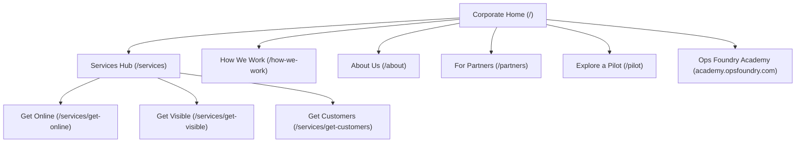
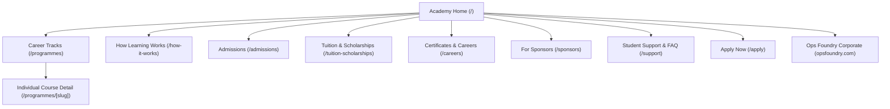
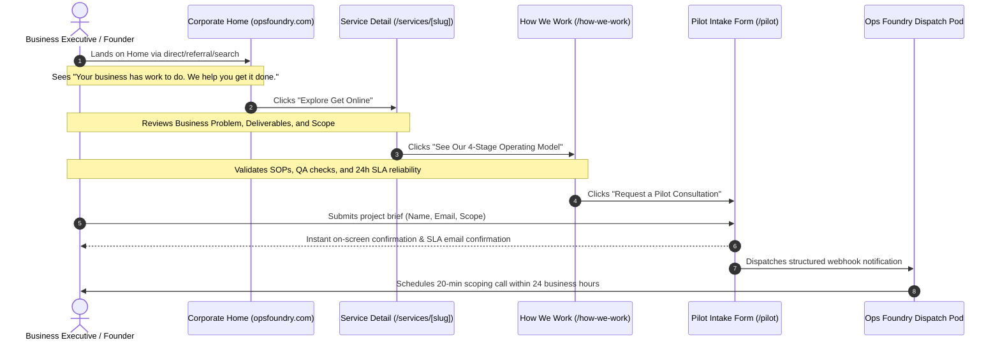
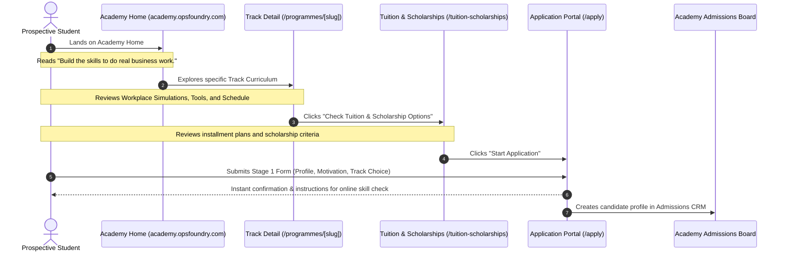
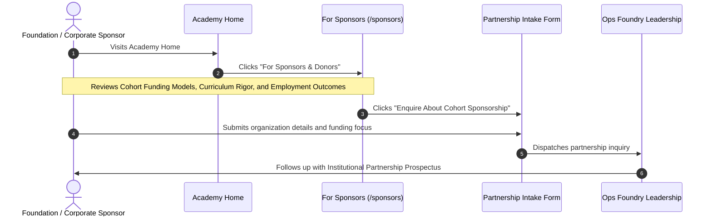

# OPS FOUNDRY — UX ARCHITECTURE & WEBSITE WIREFRAMES
**Project:** Ops Foundry (Corporate & Academy)  
**Phase:** Phase 2 — UX Architecture, Information Architecture & Visual Wireframes  
**Design Direction:** Direction C — Shared Foundation, Distinct Personalities  
**Status:** Ready for Review & Approval (Pre-Implementation)  
**Date:** November 2026  

---

## 1. UX STRATEGY & DESIGN RATIONALE

### 1.1 Dual-Experience Strategy: Shared Foundation, Distinct Personalities
Ops Foundry operates as an integrated commercial and talent engine. To maximize market impact, the digital ecosystem is divided into two focused web properties that share a single underlying design system while maintaining distinct visual and tonal identities:

```
                      ┌────────────────────────────────────────┐
                      │          OPS FOUNDRY ECOSYSTEM         │
                      │  Shared Brand, Tokens, Type & Primitives │
                      └───────────────────┬────────────────────┘
                                          │
                  ┌───────────────────────┴───────────────────────┐
                  ▼                                               ▼
     ┌────────────────────────┐                     ┌────────────────────────┐
     │   CORPORATE WEBSITE    │                     │   OPS FOUNDRY ACADEMY  │
     │   (opsfoundry.com)     │                     │ (academy.opsfoundry.com│
     ├────────────────────────┤                     ├────────────────────────┤
     │ • Audience: Businesses │                     │ • Audience: Learners,  │
     │ • Mode: Commercial B2B │                     │   Sponsors, Educators  │
     │ • Tone: Authoritative, │                     │ • Mode: Higher-Ed/EdTech│
     │   Confident, Structured│                     │ • Tone: Aspirational,  │
     │ • CTA: "Start a Pilot" │                     │   Welcoming, Credible  │
     └────────────────────────┘                     │ • CTA: "Apply Now"     │
                                                    └────────────────────────┘
```

### 1.2 Personality Differentiation Matrix

| Attribute | Corporate Website (`opsfoundry.com`) | Academy Website (`academy.opsfoundry.com`) |
| :--- | :--- | :--- |
| **Primary Goal** | Business acquisition, outsourcing contracts, pilot engagements. | Student recruitment, admissions, career outcomes, sponsor funding. |
| **Emotional Tone** | Confident, sharp, commercially disciplined, operationally intelligent. | Welcoming, aspirational, structured, practical, empowering. |
| **Visual Tone** | High-contrast industrial minimalism. Charcoal (`#111215`), crisp off-white (`#FBFBF9`), targeted Foundry Orange (`#FF5A1F`) conversion accents. | Warm architectural off-white (`#F9F9F6`), deep slate (`#1E232E`), Foundry Orange with amber/gold accents for achievement badges. |
| **Typography Weighting** | **Cabinet Grotesk** (Extrabold, tight tracking) + **Plus Jakarta Sans** (medium body) + **JetBrains Mono** (technical labels). | **Cabinet Grotesk** (Semibold/Bold, balanced tracking) + **Plus Jakarta Sans** (generous leading) + **JetBrains Mono** (module codes). |
| **Hero Image Direction** | Technical diagrams, operational pods, workflows, real operational dashboards. | Students collaborating, mentors reviewing code/work, graduation moments, workshop environments. |
| **Conversion Focus** | Low-friction consultation / pilot intake (24hr response SLA). | Structured multi-step application form, curriculum syllabus download. |

### 1.3 Typography Recommendations

1. **Display & Headings: `Cabinet Grotesk` (Recommended)**
   * *Rationale:* Cabinet Grotesk delivers an industrial, precision-engineered aesthetic with wide geometric proportions. It evokes modern operational infrastructure and serious corporate capability without feeling like a generic software template. (Alternative: `Syne` if a more avant-garde editorial look is preferred).
2. **Body & Interface: `Plus Jakarta Sans`**
   * *Rationale:* Modern humanist sans-serif with a tall x-height, open counters, and exceptional legibility across dense data tables, workflow steps, and curriculum modules.
3. **Technical Badges & Meta: `JetBrains Mono`**
   * *Rationale:* Used sparingly (11px–13px uppercase) for process step indicators (`01 / INTAKE`), SLA tags (`24H SLA`), course module codes (`MOD-01`), and status chips (`ACTIVE COHORT`). Establishes technical rigor.

---

## 2. SITEMAPS & INFORMATION ARCHITECTURE

### 2.1 Corporate Website Sitemap (`opsfoundry.com`)



#### Corporate Navigation Architecture
* **Primary Header (Desktop):**
  * Left: Ops Foundry Logo (Monogram + Wordmark).
  * Center:
    * `Services ⌵` (Mega-menu / Dropdown: *Overview*, *Get Online*, *Get Visible*, *Get Customers*).
    * `How We Work` (Operating Model).
    * `About` (Philosophy & Story).
    * `Partnerships` (Enterprise & Strategic Alliances).
  * Right:
    * `Ops Foundry Academy ↗` (Pill badge linking to `academy.opsfoundry.com`).
    * `Start a Project` (Primary solid orange CTA button linking to `/pilot`).
* **Mobile Drawer:**
  * Clean off-canvas slide-out displaying primary links, an expandable Services accordion, direct Academy gateway, and full-width "Start a Project" button.

---

### 2.2 Academy Website Sitemap (`academy.opsfoundry.com`)



#### Academy Navigation Architecture
* **Primary Header (Desktop):**
  * Left: Ops Foundry Academy Logo (Brand lockup with "ACADEMY" badge).
  * Center:
    * `Programmes ⌵` (Dropdown of confirmed career tracks).
    * `How It Works` (Simulations, Mentorship, Real Projects).
    * `Admissions` (Criteria, Process, Deadlines).
    * `Tuition & Scholarships` (Flexible payments, financial aid).
    * `For Sponsors` (Institutional funding & talent pipeline).
  * Right:
    * `Ops Foundry Corporate ↗` (Ghost link: *"Hire Our Talent"*).
    * `Apply Now` (Primary solid orange pill button linking to `/apply`).
* **Mobile Drawer:**
  * Grouped into `LEARNER PATHWAYS` (Programmes, Admissions, Tuition, How It Works) and `PARTNER & ALUMNI` (Sponsors, Hire Talent, Corporate).

---

## 3. CORPORATE HOMEPAGE WIREFRAME & SECTION BREAKDOWN

### 3.1 Section-by-Section Structural Specification

#### Section 1: Top Navigation Bar
* **Purpose:** Establish brand presence, enable swift discovery of core offerings, provide clear Academy bridge, and drive project inquiries.
* **Layout (Desktop 1440px):** Fixed sticky header with blurred background (`backdrop-blur-md bg-white/95 border-b border-gray-100`). Height: 72px. Max-width container: 1280px.
* **Components:** Brand logo left; navigation links center; Academy pill link (`border border-orange-200 text-orange-600 bg-orange-50/50`) + "Start a Project" button (`bg-[#FF5A1F] text-white`) right.
* **Mobile Layout (390px):** Logo left; "Academy ↗" icon + Hamburger toggle right. Fullscreen off-canvas menu on open.

#### Section 2: Hero Section
* **Purpose:** Immediately articulate Ops Foundry's commercial value proposition and human-AI operational model.
* **Proposed Headline:** *"Your business has work to do. We help you get it done."*
* **Supporting Content:** *"Ops Foundry builds and operates the human-AI operational infrastructure modern businesses need to execute. We combine managed teams, structured workflows, and AI-enabled tools to take you from operational backlog to measurable outcomes."*
* **Primary CTAs:**
  * Primary: `"Explore a Pilot →"` (Directs to `/pilot`).
  * Secondary: `"See How We Work"` (Smooth scrolls to `#operating-model`).
* **Visual Composition (Desktop 1440px):** 
  * Asymmetric split layout (60% left column, 40% right column).
  * Left: Clean off-white editorial card with eyebrow tag `01 / OPERATIONAL INFRASTRUCTURE`, display H1 in Cabinet Grotesk, subtext, dual CTAs, and a trust metric bar: `[Direct Intake Review | Managed Operating Pods | AI-Augmented Speed]`.
  * Right: Interactive technical schematic card showing a visual workflow diagram: `[Business Request] ➔ [Workflow Decomposition] ➔ [AI Tooling + Managed Pod] ➔ [Verified Deliverable]`.
* **Mobile Layout (390px):** Vertically stacked. Top display card with headline, copy, and full-width CTA buttons. Workflow schematic card collapses into a simplified 3-stage vertical pill sequence below.

#### Section 3: Why Ops Foundry Exists (The Problem We Solve)
* **Purpose:** Frame the macro business challenge: companies are overwhelmed with operational backlog, fragmented SaaS tools, and the complexity of managing AI alone.
* **Proposed Headline:** *"Most businesses don't lack ideas. They lack execution capacity."*
* **Supporting Content:** Narrative explaining why software subscriptions and unmanaged freelancers fail to solve operational bottlenecks. Ops Foundry delivers fully managed execution infrastructure.
* **Visual Composition (Desktop 1440px):** 2-column editorial grid. Left: Bold H2 and 3 core operational contrasts:
  * *Software alone doesn't execute work.*
  * *Unmanaged freelancers lack operational consistency.*
  * *Ops Foundry delivers structured, accountable execution.*
* **Mobile Layout (390px):** Single column with bold statements stacked with orange divider lines.

#### Section 4: The Three Operating Pillars
* **Purpose:** Introduce the three components of Ops Foundry’s operational infrastructure.
* **Proposed Headline:** *"The Three Pillars of the Foundry Infrastructure"*
* **Supporting Content:** Explanation of how human talent, rigorous processes, and AI work in unison.
* **Cards Grid (3 Columns):**
  1. **Managed Teams:** Dedicated, trained operational specialists accountable for daily execution and quality control.
  2. **Structured Workflows:** Documented, standardized Standard Operating Procedures (SOPs) engineered for consistency and error elimination.
  3. **AI-Enabled Tools:** Custom automation, LLM workflows, and purpose-built internal tooling that 5x execution speed.
* **Desktop (1440px):** 3-column card grid with `rounded-2xl border border-gray-200 bg-white p-8`. Each card features a mono tag (`PILLAR 01`, `PILLAR 02`, `PILLAR 03`) and an architectural icon.
* **Mobile (390px):** Vertically stacked swipeable cards or vertical list with left accent borders.

#### Section 5: What We Do (The Core Services)
* **Purpose:** Present the three commercial service categories in direct, outcome-focused language.
* **Proposed Headline:** *"Three Ways We Get Work Done for Your Business"*
* **Service Cards (3 Columns):**
  * **Card 1: Get Online**
    * *Tag:* `SERVICE 01 / DIGITAL FOOTPRINT`
    * *Headline:* Production-grade websites, web applications, e-commerce storefronts, and foundational digital systems built for operational reliability.
    * *Key Deliverables:* Responsive sites, CMS setup, technical infrastructure, domain/email operations.
    * *CTA:* `"Explore Get Online →"` (`/services/get-online`).
  * **Card 2: Get Visible**
    * *Tag:* `SERVICE 02 / SEARCH & DISCOVERY`
    * *Headline:* Systematic discovery, local SEO, content distribution, and technical optimization to ensure buyers find your business.
    * *Key Deliverables:* Local search setup, automated content pipelines, directory distribution, analytics tracking.
    * *CTA:* `"Explore Get Visible →"` (`/services/get-visible`).
  * **Card 3: Get Customers**
    * *Tag:* `SERVICE 03 / REVENUE OPERATIONS`
    * *Headline:* Customer acquisition workflows, inbound lead management, automated nurture pipelines, and CRM operations.
    * *Key Deliverables:* Lead intake funnels, multi-channel automated messaging, CRM setup, conversion tracking.
    * *CTA:* `"Explore Get Customers →"` (`/services/get-customers`).
* **Desktop (1440px):** 3 large interactive cards. On hover, the border shifts to Foundry Orange (`#FF5A1F`) with a subtle `translate-y-[-4px]` lift.
* **Mobile (390px):** Single-column stacked cards with prominent "Explore" links.

#### Section 6: How We Work (Proposed Operating Model — Pending Approval)
* **Purpose:** Demystify the delivery process through a structured proposed methodology.
* **Visual Style:** High-contrast dark theme container (`bg-[#111215] text-white`).
* **Proposed Headline:** *"From Operational Backlog to Measurable Outcomes"*
* **The Proposed 4-Stage Blueprint (Pending Approval):**
  * **01 / Intake & Scoping:** We audit your operational requirements and define clear deliverables, milestones, and success metrics.
  * **02 / Workflow Architecture:** We design the SOPs, configure AI-assisted tooling, and establish quality assurance checkpoints.
  * **03 / Pod Deployment & Execution:** A dedicated Ops Foundry team begins structured daily sprints with progress visibility.
  * **04 / Review & Handover:** Delivery review against initial scope, SLA reporting, and operational documentation handover.
* **Desktop (1440px):** 4-column horizontal progression with connective dotted lines and glowing orange phase markers.
* **Mobile (390px):** Vertical timeline with left-aligned vertical orange rule and numbered steps.

#### Section 7: Who We Help (Target Operational Profiles)
* **Purpose:** Enable business visitors to self-identify their operational stage and needs.
* **Proposed Headline:** *"Built for Businesses That Value Execution"*
* **Profiles (3 Columns):**
  1. **Growing Small & Medium Enterprises:** Need professional online presence, automated customer intake, and reliable operations without hiring a massive internal team.
  2. **Expanding Regional Businesses:** Need to modernize legacy operations, improve search visibility, and capture digital customer demand.
  3. **High-Velocity Founders & Teams:** Need an external operational pod to handle digital setup and customer workflows so leadership can focus on strategy.
* **Desktop Layout:** 3-column card grid on warm off-white background (`#FBFBF9`).

#### Section 8: The Talent Engine (Ops Foundry Academy Bridge)
* **Purpose:** Establish unmatched credibility by explaining *why* Ops Foundry teams execute reliably: our operators are trained and certified directly through our own Academy.
* **Proposed Headline:** *"Powered by the Ops Foundry Talent Engine"*
* **Content:** *"Every operational pod deployed by Ops Foundry is staffed by certified operators trained in our own rigorous Academy. We bridge rigorous practical training with real-world business execution."*
* **Components:** 2-column container. Left: Editorial explanation. Right: Academy preview card with button `"Visit Ops Foundry Academy ↗"`.
* **Desktop Layout:** Elevated card with an orange border accent on off-white ground.

#### Section 9: Insights & Perspectives
* **Purpose:** Showcase operational thinking, frameworks, and practical guides on human-AI collaboration.
* **Proposed Headline:** *"Perspectives on Operations, AI & Execution"*
* **3 Topic Cards:**
  1. *The Human-in-the-Loop Advantage: Why AI Tools Need Managed Operators.*
  2. *Standard Operating Procedures as Code: Building Resilient Workflows.*
  3. *From Chaos to Predictability: Modernizing Small Business Digital Ops.*
* **CTA:** `"Read All Perspectives →"` (`/insights`).

#### Section 10: Pilot Consultation & Project Intake CTA
* **Purpose:** Primary commercial conversion point. Captures qualified project briefs for team review.
* **Proposed Headline:** *"Ready to get the work done? Start with an operational pilot."*
* **Response Policy:** `[Our operations team will review your inquiry and follow up directly]`
* **Form Structure:**
  * Field 1: Your Name (Text)
  * Field 2: Business Email (Email)
  * Field 3: Company Name & Website (Text)
  * Field 4: Primary Service Required (Select: *Get Online* | *Get Visible* | *Get Customers* | *Custom Operations*)
  * Field 5: What work needs to be done? (Textarea)
  * Button: Full-width solid orange button: `"Request Pilot Consultation →"`
* **Desktop (1440px):** 2-column split. Left: Direct contact details, office location, SLA badge. Right: White elevated card housing the intake form.
* **Mobile (390px):** Single-column stacked form.

#### Section 11: Global Corporate Footer
* **Color:** Deep industrial black (`#111215`).
* **Structure (4 Columns Desktop):**
  * Column 1: Brand lockup, mission summary, registered entity details, copyright notice.
  * Column 2: Services (*Overview*, *Get Online*, *Get Visible*, *Get Customers*).
  * Column 3: Company & Ecosystem (*How We Work*, *About*, *For Partners*, *Ops Foundry Academy*).
  * Column 4: Contact & Legal (*Office Address*, *hello@opsfoundry.com*, *Privacy Policy*, *Terms of Engagement*).

---

### 3.2 Visual Wireframe: Corporate Homepage (Desktop 1440px)

```
+---------------------------------------------------------------------------------------------------------+
| [LOGO] Ops Foundry       Services [v]   How We Work   About   Partners    [ Academy ↗ ] [ Start a Project ]|
+---------------------------------------------------------------------------------------------------------+
|                                                                                                         |
|  [ EYEBROW: 01 / OPERATIONAL INFRASTRUCTURE ]                                                           |
|                                                                                                         |
|  Your business has work to do.                    +--------------------------------------------------+  |
|  We help you get it done.                         | OPERATIONAL SCHEMATIC ENGINE                     |  |
|                                                   |                                                  |  |
|  Ops Foundry builds and operates the human-AI     |  [ Business Backlog ]                            |  |
|  operational infrastructure modern businesses     |           |                                      |  |
|  need to execute. We combine managed teams,       |           v                                      |  |
|  structured workflows, and AI-enabled tools to    |  [ Workflow Decomposition & SOPs ]               |  |
|  take you from backlog to measurable outcomes.    |           |                                      |  |
|                                                   |           v                                      |  |
|  [ Explore a Pilot -> ]   [ See How We Work ]     |  [ Managed Pod ] <---> [ AI Tooling Engine ]     |  |
|                                                   |           |                                      |  |
|  -----------------------------------------------  |           v                                      |  |
|  * Direct Intake Review * Managed Pods  * AI Speed |  [ Verified Outcome / Delivered Work ]           |  |
|                                                   +--------------------------------------------------+  |
+---------------------------------------------------------------------------------------------------------+
|                                                                                                         |
|  THE PROBLEM WE SOLVE                                                                                   |
|  "Most businesses don't lack ideas. They lack execution capacity."                                      |
|                                                                                                         |
|  Software subscriptions don't execute work. Unmanaged freelancers lack operational consistency.         |
|  Ops Foundry provides the dedicated infrastructure to turn business priorities into finished execution. |
|                                                                                                         |
+---------------------------------------------------------------------------------------------------------+
|  THE THREE OPERATING PILLARS                                                                            |
|                                                                                                         |
|  +---------------------------+  +---------------------------+  +---------------------------+            |
|  | PILLAR 01                 |  | PILLAR 02                 |  | PILLAR 03                 |            |
|  | Managed Teams             |  | Structured Workflows      |  | AI-Enabled Tools          |            |
|  | Dedicated, trained        |  | Standard operating        |  | Intelligent automation    |            |
|  | operational operators     |  | procedures and QA checks  |  | and custom LLM workflows  |            |
|  | embedded in your business |  | built for precision.      |  | that multiply output speed|            |
|  +---------------------------+  +---------------------------+  +---------------------------+            |
+---------------------------------------------------------------------------------------------------------+
|  CORE SERVICES: THREE WAYS WE GET WORK DONE                                                             |
|                                                                                                         |
|  +---------------------------+  +---------------------------+  +---------------------------+            |
|  | GET ONLINE                |  | GET VISIBLE               |  | GET CUSTOMERS             |            |
|  | Websites, platforms, and  |  | Search discovery, SEO,    |  | Funnel operations, lead   |            |
|  | foundational digital      |  | local maps, and content   |  | management, and automated |            |
|  | operating systems.        |  | distribution pipelines.   |  | conversion workflows.     |            |
|  |                           |  |                           |  |                           |            |
|  | [ Explore Get Online -> ] |  | [ Explore Get Visible -> ]|  | [ Explore Get Customers ->|            |
|  +---------------------------+  +---------------------------+  +---------------------------+            |
+---------------------------------------------------------------------------------------------------------+
|  HOW WE WORK (DARK THEME - CARBON BLACK #111215)                                                         |
|  "From Operational Backlog to Measurable Outcomes"                                                      |
|                                                                                                         |
|   [01] INTAKE & SCOPING ----> [02] WORKFLOW ARCHITECTURE ----> [03] POD DEPLOYMENT ----> [04] DELIVERY  |
|   Audit needs, define         Design SOPs, toolchain,          Trained operators deploy    Continuous   |
|   deliverables & 24h SLA.     and QA acceptance rules.         in structured sprints.      reporting.   |
+---------------------------------------------------------------------------------------------------------+
|  THE TALENT ENGINE: OPS FOUNDRY ACADEMY                                                                 |
|  Why our execution is consistent: our operators are trained and certified in our own Academy.           |
|  [ Learn About Ops Foundry Academy ↗ ]                                                                  |
+---------------------------------------------------------------------------------------------------------+
|  READY TO GET THE WORK DONE?                                                                            |
|                                                                                                         |
|  Request an Operational Pilot                     +--------------------------------------------------+  |
|  Guaranteed response within 24 business hours.    | Name:     [____________________________________] |  |
|                                                   | Email:    [____________________________________] |  |
|  * Email: hello@opsfoundry.com                    | Company:  [____________________________________] |  |
|  * Location: Commercial Office Hub                | Service:  [ Select Service v                   ] |  |
|  * Response SLA: Under 24 Hours                   | Scope:    [ What work needs to be done?       ] |  |
|                                                   |           [ [ Request Pilot Consultation -> ]  ] |  |
|                                                   +--------------------------------------------------+  |
+---------------------------------------------------------------------------------------------------------+
|  FOOTER (CARBON BLACK #111215)                                                                          |
|  Ops Foundry Monogram        Services             Company              Contact                          |
|  Human-AI Infrastructure     - Get Online         - How We Work        hello@opsfoundry.com             |
|  (c) 2026 Ops Foundry Ltd.   - Get Visible        - About Us           Commercial Office Hub            |
|  All rights reserved.        - Get Customers      - Academy ↗          Privacy & Terms                  |
+---------------------------------------------------------------------------------------------------------+
```

### 3.3 Visual Wireframe: Corporate Homepage (Tablet 768px & Mobile 390px)

```
TABLET (768px Viewport)                           MOBILE (390px Viewport)
+---------------------------------------+         +----------------------------------+
| [LOGO] Ops Foundry  [Acad ↗] [Menu =] |         | [LOGO]        [Acad ↗]  [Menu =] |
+---------------------------------------+         +----------------------------------+
| Your business has work to do.         |         | Your business has                |
| We help you get it done.              |         | work to do.                      |
|                                       |         | We help you get it done.         |
| Ops Foundry builds and operates the   |         |                                  |
| human-AI infrastructure modern        |         | Human-AI operational             |
| businesses need to execute.           |         | infrastructure for modern        |
|                                       |         | businesses.                      |
| [ Explore a Pilot -> ]                |         |                                  |
| [ See How We Work    ]                |         | [ Explore a Pilot ->           ] |
|                                       |         | [ See How We Work              ] |
| +-----------------------------------+ |         |                                  |
| | SCHEMATIC: Backlog -> SOP -> Pod  | |         | +------------------------------+ |
| +-----------------------------------+ |         | | WORKFLOW SCHEMATIC           | |
|                                       |         | | Backlog -> SOP -> Pod -> Done| |
| THREE PILLARS (Stacked 2 + 1)         |         | +------------------------------+ |
| +-----------------+ +---------------+ |         |                                  |
| | 01 Managed Team | | 02 Workflows  | |         | THREE PILLARS (Vertical Stack)   |
| +-----------------+ +---------------+ |         | +------------------------------+ |
| +-----------------------------------+ |         | | 01 Managed Teams             | |
| | 03 AI-Enabled Tools               | |         | +------------------------------+ |
| +-----------------------------------+ |         | | 02 Structured Workflows      | |
|                                       |         | +------------------------------+ |
| SERVICES (Vertical Stacked Cards)     |         | | 03 AI-Enabled Tools          | |
| +-----------------------------------+ |         | +------------------------------+ |
| | GET ONLINE                        | |         |                                  |
| | [ Explore Get Online -> ]         | |         | CORE SERVICES                    |
| +-----------------------------------+ |         | +------------------------------+ |
| | GET VISIBLE                       | |         | | GET ONLINE                   | |
| | [ Explore Get Visible -> ]        | |         | | [ Explore -> ]               | |
| +-----------------------------------+ |         | +------------------------------+ |
| | GET CUSTOMERS                     | |         | | GET VISIBLE                  | |
| | [ Explore Get Customers -> ]      | |         | | [ Explore -> ]               | |
| +-----------------------------------+ |         | +------------------------------+ |
|                                       |         | | GET CUSTOMERS                | |
| HOW WE WORK (Vertical Progress)       |         | | [ Explore -> ]               | |
| [01] -> [02] -> [03] -> [04]          |         | +------------------------------+ |
|                                       |         |                                  |
| PILOT INTAKE FORM (Single Column)     |         | HOW WE WORK (Dark Section)       |
| +-----------------------------------+ |         | 01. Intake & Scoping (24h SLA)   |
| | Name / Email / Company / Brief    | |         | 02. Workflow Architecture        |
| | [ Request Pilot Consultation -> ] | |         | 03. Pod Deployment & Execution   |
| +-----------------------------------+ |         | 04. Outcome Delivery & QA        |
|                                       |         |                                  |
| FOOTER (2 Column Grid)                |         | PILOT INTAKE FORM                |
| Brand & Links                         |         | [ Full-width inputs & submit ]   |
+---------------------------------------+         +----------------------------------+
```

---

## 4. ACADEMY HOMEPAGE WIREFRAME & SECTION BREAKDOWN

### 4.1 Section-by-Section Structural Specification

#### Section 1: Academy Navigation Bar
* **Brand:** Ops Foundry Academy lockup.
* **Links:** `Programmes`, `How It Works`, `Admissions`, `Tuition & Financial Aid`, `For Sponsors`.
* **Actions:** `Ops Foundry Corporate ↗` (Ghost link) + `Apply Now` (Solid orange pill button).

#### Section 2: Hero Section
* **Purpose:** Establish aspirational, career-transforming, yet practical tone for learners.
* **Proposed Headline:** *"Build the skills to do real business work."*
* **Supporting Content:** *"Ops Foundry Academy trains the next generation of operational specialists. Learn through workplace simulations, master modern AI-enabled workflows, and graduate with verified capability."*
* **CTAs:**
  * Primary: `"Explore Programmes →"` (`#programmes`).
  * Secondary: `"How Learning Works"` (`/how-it-works`).
* **Visual Composition (1440px):** Warm off-white ground. Left: Display typography with active status chip: `[ADMISSIONS OPEN: UPCOMING COHORT]`. Right: Workplace simulation interface preview showing student project dashboard with real-time competency feedback.

#### Section 3: Introduction to the Academy ("The Practical Model")
* **Purpose:** Differentiate from theoretical MOOCs or abstract bootcamps.
* **Key Idea:** We do not teach passive theory. We train operational operators inside realistic business environments.

#### Section 4: Available Programmes / Career Tracks
* **Note on Accuracy:** Specific course tracks are pending final confirmation.
* **Structure:** High-card grid featuring placeholder track architecture:
  * **Track 01:** `[Pending Confirmation: Track A - Web & Digital Operations]`
  * **Track 02:** `[Pending Confirmation: Track B - Search, Discovery & Content Ops]`
  * **Track 03:** `[Pending Confirmation: Track C - Revenue & Customer Acquisition Ops]`
* **Card Details:** Duration (Weeks), Format (Full-time / Part-time), Core Competencies, Capstone Project, `"View Syllabus & Apply →"`.

#### Section 5: Practical Learning & Workplace Simulations
* **Purpose:** Explain the pedagogical engine: simulations instead of lectures.
* **3 Pillars:**
  1. *Simulated Business Environments:* Work on real ticketing backlogs, real client scenarios, and production toolchains.
  2. *AI-Augmented Execution:* Learn how to prompt, automate, and accelerate output using modern LLM tools.
  3. *Expert Operational Mentors:* Feedback from practicing senior operators.

#### Section 6: Assessment & Competency Development
* **Purpose:** Establish academic and practical credibility.
* **Model:** No multiple-choice tests. Graded on delivered output, speed, adherence to SOPs, and QA error rates.

#### Section 7: Tuition, Scholarships & Financial Support
* **Purpose:** Demystify costs and present accessible pathways.
* **Components:**
  * Transparent tuition policy `[Pending Confirmation: Exact Tuition Amounts]`.
  * Merit & Need-based Scholarship overview `[Pending Confirmation: Scholarship Terms]`.
  * Flexible installment options.
* **CTA:** `"Review Tuition & Funding Options →"` (`/tuition-scholarships`).

#### Section 8: Career Opportunities & Practical Competencies
* **Purpose:** Direct alignment with practical workplace demands.
* **The Ops Foundry Advantage:** Graduates are equipped with demonstrable, verified operational capabilities relevant to modern business employers. No automatic placement is guaranteed, but learners graduate with a portfolio of completed workplace simulations.

#### Section 9: For Sponsors & Institutional Partners
* **Purpose:** Invite donors, development agencies, and corporate sponsors to fund cohorts.
* **Value Prop:** Fund high-impact digital skills training with measurable employment outcomes.
* **CTA:** `"Partner With the Academy →"` (`/sponsors`).

#### Section 10: Final Admissions CTA
* **Headline:** *"Your career in modern operations starts here."*
* **Supporting:** *"Applications for the next cohort are now being reviewed on a rolling basis."*
* **CTA:** `"Start Your Application →"` (`/apply`).

#### Section 11: Academy Footer
* **Color:** Deep Slate (`#1E232E`).
* **Columns:** Academy brand summary, Programme links, Admissions links, Corporate switch link, legal information.

---

### 4.2 Visual Wireframe: Academy Homepage (Desktop 1440px)

```
+---------------------------------------------------------------------------------------------------------+
| [LOGO] Ops Foundry ACADEMY    Programmes [v]   How It Works   Admissions   Tuition   [ Corporate ↗ ] [ Apply Now ] |
+---------------------------------------------------------------------------------------------------------+
|                                                                                                         |
|  [ STATUS: ADMISSIONS OPEN - NEXT COHORT ]                                                              |
|                                                                                                         |
|  Build the skills to do                           +--------------------------------------------------+  |
|  real business work.                              | SIMULATED WORKPLACE INTERFACE                    |  |
|                                                   |                                                  |  |
|  Ops Foundry Academy trains the next generation   |  Cohort Sprint: Week 04 - Live Simulation        |  |
|  of operational specialists. Master structured    |  Task: Configure Automated CRM Lead Pipeline     |  |
|  workflows, leverage modern AI tools, and         |  Status: [ In Review - QA 98% Score ]            |  |
|  graduate with verified portfolio capability.     |                                                  |  |
|                                                   |  Feedback: "SOP executed accurately. AI prompt   |  |
|  [ Explore Programmes -> ]  [ How Learning Works ]|  template generated zero syntax errors."         |  |
|                                                   +--------------------------------------------------+  |
+---------------------------------------------------------------------------------------------------------+
|  THE PRACTICAL LEARNING MODEL                                                                           |
|  No passive lectures. No abstract theory. You learn by doing real operational work.                     |
+---------------------------------------------------------------------------------------------------------+
|  AVAILABLE PROGRAMMES & CAREER TRACKS                                                                   |
|                                                                                                         |
|  +---------------------------+  +---------------------------+  +---------------------------+            |
|  | [TRACK 01: PENDING CONF.] |  | [TRACK 02: PENDING CONF.] |  | [TRACK 03: PENDING CONF.] |            |
|  | Web & Digital Operations  |  | Search & Discovery Ops    |  | Revenue & Customer Ops    |            |
|  | Duration: [Pending] Weeks |  | Duration: [Pending] Weeks |  | Duration: [Pending] Weeks |            |
|  | Format: Hybrid / Practical|  | Format: Hybrid / Practical|  | Format: Hybrid / Practical|            |
|  | Focus: Digital Footprint  |  | Focus: SEO & Distribution |  | Focus: CRM & Inbound Lead |            |
|  | [ View Syllabus -> ]      |  | [ View Syllabus -> ]      |  | [ View Syllabus -> ]      |            |
|  +---------------------------+  +---------------------------+  +---------------------------+            |
+---------------------------------------------------------------------------------------------------------+
|  HOW LEARNING WORKS: THREE TRAINING PILLARS                                                             |
|                                                                                                         |
|  [ 01 / SIMULATION ]             [ 02 / AI TOOLING ]            [ 03 / PORTFOLIO DELIVERABLES ]         |
|  Work inside replicated          Master LLMs, automations,      Graduate with verified proof of         |
|  client company backlogs.        and modern productivity tools. completed operational projects.         |
+---------------------------------------------------------------------------------------------------------+
|  TUITION & SCHOLARSHIP OPPORTUNITIES                                                                    |
|  Transparent tuition and merit/need-based scholarship funding options available.                        |
|  [ Review Tuition Details -> ]   [ Check Scholarship Eligibility -> ]                                   |
+---------------------------------------------------------------------------------------------------------+
|  THE EMPLOYMENT CONNECTION                                                                              |
|  Graduates are equipped with practical operational skills relevant to modern employers.  |
|  [ Explore Career Outcomes -> ]                                                                         |
+---------------------------------------------------------------------------------------------------------+
|  READY TO START YOUR APPLICATION?                                                                       |
|  Take the first step toward a verified career in digital operations.                                    |
|  [ Start Your Application Now -> ]                                                                      |
+---------------------------------------------------------------------------------------------------------+
|  ACADEMY FOOTER (DEEP SLATE #1E232E)                                                                    |
|  Ops Foundry Academy         Programmes           Admissions           Ecosystem                        |
|  Practical Training Engine   - Track 01           - Process            - Ops Foundry Corporate ↗        |
|  (c) 2026 Ops Foundry Ltd.   - Track 02           - Tuition            - Hire Our Graduates             |
|  All rights reserved.        - Track 03           - Scholarships       - Sponsor a Cohort               |
+---------------------------------------------------------------------------------------------------------+
```

---

## 5. SUPPORTING PAGE WIREFRAMES

### 5.1 Reusable Corporate Service Detail Page (`/services/[slug]`)
*Universal structure applied to `Get Online`, `Get Visible`, and `Get Customers`.*

```
+---------------------------------------------------------------------------------------------------------+
| [HEADER - GLOBAL STICKY]                                                                                |
+---------------------------------------------------------------------------------------------------------+
|  BREADCRUMB: Home / Services / Get Online                                                               |
|                                                                                                         |
|  [ SERVICE EYEBROW: 01 / DIGITAL FOOTPRINT ]                                                            |
|  GET ONLINE                                                                                             |
|  Production-grade websites, web applications, and digital business systems built for reliability.      |
|                                                                                                         |
|  [ Explore a Pilot for Get Online -> ]             [ Download Service Brief PDF ]                       |
+---------------------------------------------------------------------------------------------------------+
|  THE BUSINESS PROBLEM                                                                                   |
|  Why traditional web design fails: Slow agency delivery, brittle DIY builders, and no operational      |
|  support after launch. Ops Foundry builds your digital presence as an operational asset.                |
+---------------------------------------------------------------------------------------------------------+
|  WHAT THE SERVICE DELIVERS (3 KEY OUTCOMES)                                                             |
|  +---------------------------+  +---------------------------+  +---------------------------+            |
|  | 01 / Production Website   |  | 02 / Business Systems     |  | 03 / Ongoing Maintenance  |            |
|  | Custom responsive site    |  | Email, domain DNS, CRM    |  | Weekly updates, security  |            |
|  | built on Next.js/Tailwind |  | intake, & payment setup.  |  | monitoring, and QA uptime |            |
|  +---------------------------+  +---------------------------+  +---------------------------+            |
+---------------------------------------------------------------------------------------------------------+
|  DETAILED SCOPE & DELIVERABLES MATRIX                                                                   |
|  +--------------------------------------------+-------------------------------------------------------+ |
|  | INCLUDED IN GET ONLINE                     | CLIENT DELIVERABLES / INPUTS NEEDED                   | |
|  | - Complete UX architecture & design        | - Brand assets & brand guidelines                     | |
|  | - Custom responsive frontend build         | - Raw product/service content & photography           | |
|  | - CMS configuration for team editing       | - Domain registrar access                             | |
|  | - Technical SEO foundation                 | - Designated point of contact for sprint sign-off     | |
|  | - 24h SLA intake setup                     |                                                       | |
|  +--------------------------------------------+-------------------------------------------------------+ |
+---------------------------------------------------------------------------------------------------------+
|  HOW ENGAGEMENT WORKS (THE SPRINT MODEL)                                                                |
|  [ Week 1: Intake & Architecture ] -> [ Week 2-3: Build & Integration ] -> [ Week 4: QA, Launch & Handover ] |
+---------------------------------------------------------------------------------------------------------+
|  PILOT CALL TO ACTION                                                                                   |
|  "Deploy a Get Online Pilot for Your Business"                                                          |
|  [ Request Pilot Brief -> ]                                                                             |
+---------------------------------------------------------------------------------------------------------+
| [FOOTER - GLOBAL DARK]                                                                                  |
+---------------------------------------------------------------------------------------------------------+
```

### 5.2 Academy Programme Detail Page (`/programmes/[slug]`)
*Universal structure applied to each confirmed Academy course.*

```
+---------------------------------------------------------------------------------------------------------+
| [HEADER - ACADEMY STICKY]                                                                               |
+---------------------------------------------------------------------------------------------------------+
|  BREADCRUMB: Home / Programmes / Web & Digital Operations                                               |
|                                                                                                         |
|  [ TRACK EYEBROW: FULL-TIME / HYBRID ]                                                                  |
|  [Pending Confirmation: Course Name]                                                                    |
|  Master the deployment, management, and continuous operation of production digital web systems.         |
|                                                                                                         |
|  * Duration: [Pending] Weeks   * Schedule: [Pending]   * Prerequisite: [Pending]                        |
|                                                                                                         |
|  [ Apply for This Programme -> ]                   [ Download Syllabus (PDF) ]                          |
+---------------------------------------------------------------------------------------------------------+
|  WHO THIS PROGRAMME IS FOR                                                                              |
|  - Motivated individuals seeking career entry into digital operations.                                  |
|  - Junior operators wanting to master AI-augmented workflows.                                           |
|  - Professionals transitioning from administrative roles into modern digital ops.                       |
+---------------------------------------------------------------------------------------------------------+
|  CURRICULUM ARCHITECTURE (MODULAR BREAKDOWN)                                                            |
|  +----------------------------------------------------------------------------------------------------+ |
|  | MODULE 01: Operational Foundations & Standard Operating Procedures                                  | |
|  | Understanding business backlogs, ticketing systems, documentation, and quality assurance.           | |
|  +----------------------------------------------------------------------------------------------------+ |
|  | MODULE 02: Tooling & The Modern Digital Stack                                                       | |
|  | Mastering CMS platforms, basic web architectures, domain/DNS management, and automation hooks.     | |
|  +----------------------------------------------------------------------------------------------------+ |
|  | MODULE 03: AI Prompting & Workflow Acceleration                                                      | |
|  | Leveraging LLMs to generate documentation, audit code, and accelerate daily execution.              | |
|  +----------------------------------------------------------------------------------------------------+ |
|  | MODULE 04: Capstone Workplace Simulation                                                            | |
|  | Execute an end-to-end client digital deployment under timed, real-world operational pressure.       | |
|  +----------------------------------------------------------------------------------------------------+ |
+---------------------------------------------------------------------------------------------------------+
|  TUITION & PAYMENT OPTIONS FOR THIS TRACK                                                               |
|  Full Tuition: [Pending Amount]  |  Installment Plan: [Pending Details]  |  Scholarship Eligible: [Yes] |
+---------------------------------------------------------------------------------------------------------+
|  FINAL APPLICATION CALL TO ACTION                                                                       |
|  "Ready to enroll in [Pending Course Name]?"                                                            |
|  [ Start Application Now -> ]                                                                           |
+---------------------------------------------------------------------------------------------------------+
```

---

## 6. SHARED DESIGN SYSTEM SPECIFICATION

```
DESIGN SYSTEM TOKENS & COMPONENTS (Direction C)
├── Foundation Tokens (100% Shared Across Both Properties)
│   ├── Colors: Foundry Orange (#FF5A1F), Industrial Black (#111215), Off-White (#FBFBF9)
│   ├── Typography Families: Cabinet Grotesk (Headings), Plus Jakarta Sans (Body), JetBrains Mono (Meta)
│   ├── Spacing Scale: 4px base (8, 12, 16, 24, 32, 48, 64, 96, 128px)
│   └── Radius Scale: sm (4px), md (8px), lg (12px), xl (16px), 2xl (24px), full (9999px)
│
├── Component Specialization
│   ├── Corporate Variants:
│   │   ├── High-contrast Carbon Black (#111215) dark sections
│   │   ├── Sharp technical badges (`01 / OPERATIONAL INFRASTRUCTURE`)
│   │   ├── Single-stage intake form with 24h SLA counter
│   │   └── Corporate Header with Academy pill badge
│   └── Academy Variants:
│       ├── Deep Slate (#1E232E) dark sections for warmer scholastic feel
│       ├── Soft amber/gold accents for achievements and certificates
│       ├── Multi-stage application modal with progress bar
│       └── Academy Header with Corporate "Hire Talent" pill link
```

### 6.1 Token Table

| Token Name | Value | Corporate Usage | Academy Usage |
| :--- | :--- | :--- | :--- |
| `color-primary-orange` | `#FF5A1F` | Main CTAs, active hover states, process focus. | Main CTAs, enrollment buttons, badge accents. |
| `color-bg-light` | `#FBFBF9` | Global page ground, alternating clean sections. | Global page ground, warm editorial reading areas. |
| `color-bg-dark` | `#111215` | *How We Work* section, Global Corporate Footer. | N/A (reserved for Corporate technical authority). |
| `color-bg-dark-slate`| `#1E232E` | N/A | *How Learning Works*, Global Academy Footer. |
| `color-card-white` | `#FFFFFF` | Service cards, intake form container. | Course track cards, curriculum accordions. |
| `color-border-subtle`| `#E5E7EB` | Card dividers, input borders, nav border. | Card dividers, input borders, nav border. |
| `color-text-primary` | `#111827` | Headings, primary reading text. | Headings, primary reading text. |
| `color-text-muted` | `#6B7280` | Subtitles, supporting descriptions, metadata. | Subtitles, syllabus descriptions, metadata. |

### 6.2 Button & Control Matrix

* **Primary Solid Button (`btn-primary`):**  
  `bg-[#FF5A1F] text-white font-medium rounded-full px-7 py-3.5 hover:bg-[#E04B14] transition-all duration-200 active:scale-[0.98]`.
* **Secondary Ghost Button (`btn-secondary`):**  
  `bg-transparent border border-gray-300 text-gray-900 rounded-full px-7 py-3.5 hover:border-gray-900 hover:bg-gray-50 transition-all duration-200`.
* **Inverted Dark Button (`btn-inverted`):**  
  `bg-white text-[#111215] font-medium rounded-full px-7 py-3.5 hover:bg-gray-100 transition-all duration-200`.
* **Cross-Site Gateway Badge:**  
  `text-xs uppercase tracking-wider font-mono px-3.5 py-1.5 rounded-full border border-orange-200 bg-orange-50 text-orange-700 hover:bg-orange-100 transition-colors`.

---

## 7. USER JOURNEYS & CONVERSION PATHS

### 7.1 Corporate Journey: Business Decision-Maker



---

### 7.2 Academy Journey: Prospective Learner



---

### 7.3 Partner / Sponsor Journey: Institutional Leader or Corporate Donor



---

## 8. OUTSTANDING CONTENT & BUSINESS DECISIONS

The following items require confirmation from leadership before final production content and database integrations are finalized:

| Decision Item | Current Wireframe Status | Impact / Dependency |
| :--- | :--- | :--- |
| **Academy Course Catalog** | Tagged as `[Pending Confirmation]`. Avoided inventing the legacy 4-track model. | Requires finalized names, durations (e.g. 8 vs 12 weeks), syllabi, and prerequisites. |
| **Tuition Amounts & Currency** | Tagged as `[Pending Confirmation]`. | Requires local and international tuition fee schedule and installment options. |
| **Scholarship Criteria** | Outlined structurally with placeholders. | Requires defined eligibility rules, funding partners, and quotas per cohort. |
| **Cohort Start Dates** | Marked with `[Upcoming Cohort]` status chips. | Requires operational timeline for the inaugural Academy batch. |
| **Service Pricing / Pilot Tiers** | Structured around custom scoping with a 24h SLA. | Decide whether to publish starting prices (e.g. *"Pilots from $X"*) or retain bespoke intake. |
| **Commercial Entity Details** | Placed in footer as `Ops Foundry Ltd.`. | Needs official registered legal name, company registration number, and primary registered office address. |

---

## 9. RECOMMENDATIONS FOR THE IMPLEMENTATION PHASE

To maintain separation of concerns while maximizing codebase reuse, the following technical architecture is recommended for Phase 3:

```
                  ┌────────────────────────────────────────┐
                  │          SHARED MONOREPO (pnpm)        │
                  ├────────────────────────────────────────┤
                  │  packages/ui       (Shared Components) │
                  │  packages/tokens   (Tailwind Preset)   │
                  │  packages/types    (Data Models)       │
                  └───────────────────┬────────────────────┘
                                      │
                  ┌───────────────────┴───────────────────┐
                  ▼                                       ▼
     ┌────────────────────────┐             ┌────────────────────────┐
     │   apps/corporate       │             │   apps/academy         │
     │   (Next.js App Router) │             │   (Next.js App Router) │
     │   opsfoundry.com       │             │   academy.opsfoundry.com   │
     └────────────────────────┘             └────────────────────────┘
```

1. **Monorepo Setup:** A lightweight monorepo (using Turborepo or pnpm workspaces) hosting `apps/corporate`, `apps/academy`, and `packages/ui` (shared components and Tailwind presets).
2. **Domain Architecture:** `opsfoundry.com` for Corporate; `academy.opsfoundry.com` as a distinct application deployment sharing SSL certificates and sessions.
3. **Headless CMS Strategy:** Content collections for Services, Perspectives/Insights, and Academy Programmes managed through a structured markdown/MDX setup or headless CMS (e.g., Sanity, Strapi, or Contentful).
4. **Form Handling & CRM Integration:** Server actions with validation (Zod) posting directly to an operational dispatch webhook (e.g., Slack, HubSpot, or custom CRM) for timely follow-up.
5. **Phase Approval Checklist:**
   * [x] Reference Analysis (TeleSoftas teardown completed).
   * [x] Information Architecture & Sitemaps defined.
   * [x] Low-to-Mid Fidelity Wireframes created for both properties.
   * [x] Shared Design System tokens and component rules established.
   * [ ] **User Approval Required:** Authorize transition to Phase 3 (High-Fidelity Visual Design & Component Implementation).
